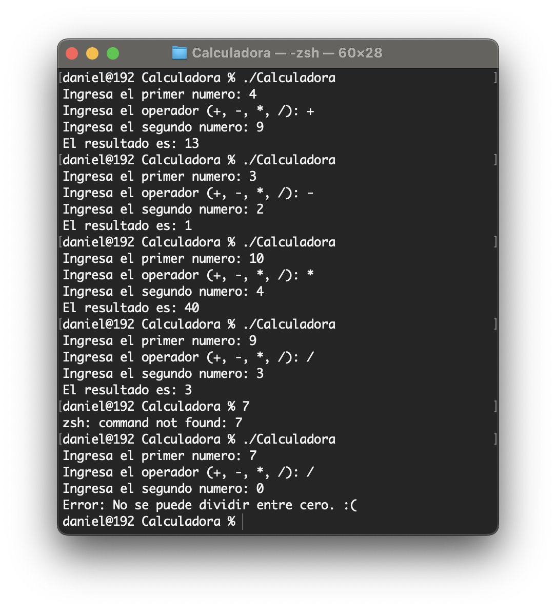
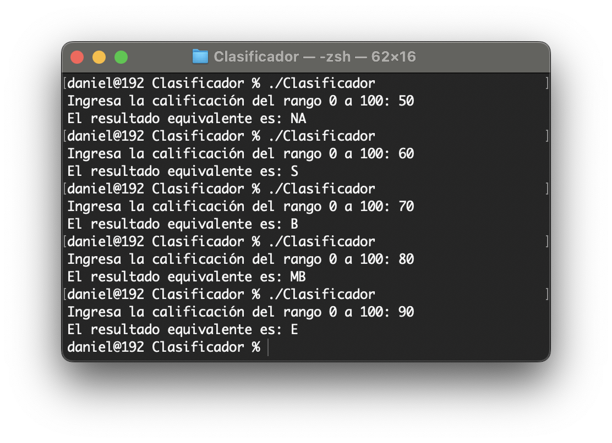
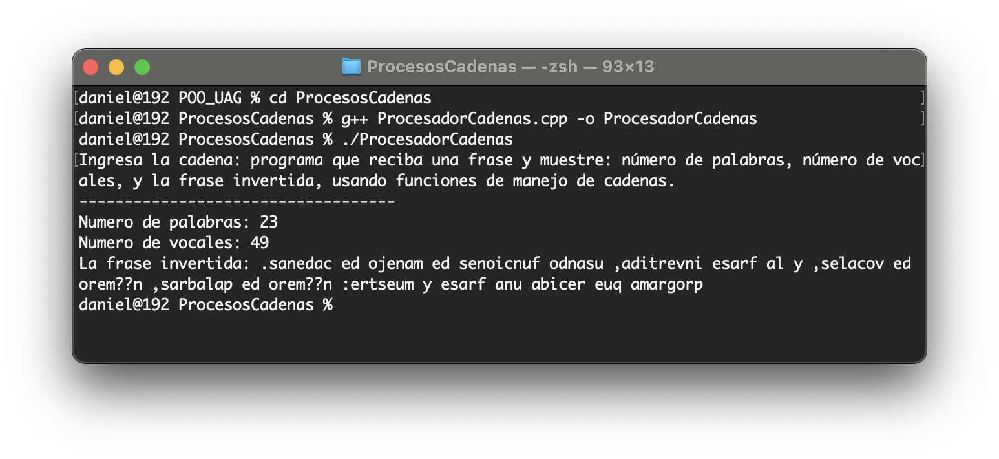
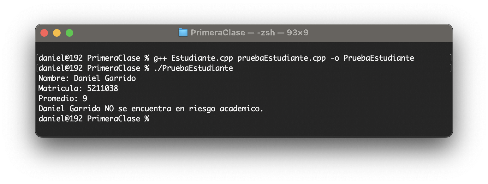
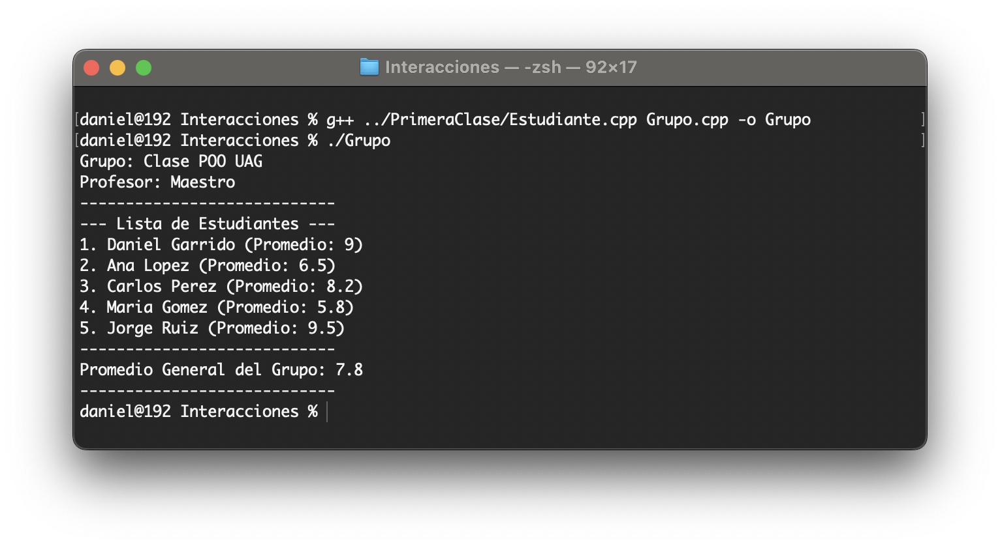

# Practicas - 1er Parcial

## Unidad 1: Introducción al Lenguaje OO  |  Unidad 2: Objetos y Clases

> Alumno: Daniel Ernesto Garrido Sánchez
> Matrícula: 5211038
> Licenciatura: Ing. de software y Minería de Datos

Esta tarea integra 5 ejercicios cortos que demandan escribir, correr y depurar código propio, además de documentarlo bajo estándares del mundo laboral: aportando evidencia de su funcionamiento, manteniendo el código en un repositorio público y sumando una reflexión honesta sobre las complicaciones enfrentadas. Mantener esta práctica `—código + evidencia + reflexión—` define exactamente lo que se espera de los profesionales en cualquier equipo de desarrollo.

### Ejercicios. 

| # | Programa | Descripción / Requisitos | Captura de pantalla |
|---|---|---|---|
| 1 | Calculadora de consola | Leer dos números y un operador (+, -, *, /), mostrar el resultado y validar división entre cero. |  |
| 2 | Clasificador con sentencias de control | Recibir una calificación de 0 a 100 y mostrar NA, S, B, MB o E usando if/else o switch. |  |
| 3 | Procesador de cadenas | Recibir una frase y mostrar número de palabras, número de vocales y la frase invertida. |  |
| 4 | Tu primera clase | Crear la clase Estudiante con nombre, matrícula y promedio, además de al menos dos métodos. Crear y probar un objeto. |  |
| 5 | Interacción entre objetos | Crear la clase Grupo con un arreglo de mínimo 3 objetos Estudiante y calcular el promedio general. |  |

#### Reflexión de los ejercicios

Aprendí la importancia de 4 pilares de la programación, los atributos y métodos que se le tienen que ingresaar y la diferencia que tienen uno tiene y el otro hace, lo complicado fue hacer el proceso de elección de los métodos y atributos incluyendo la división entre 0.

También aprendí lo importante que puede ser la toma de decisiones de un programa, fue confuso organizarlos de la manera correcta tuve que apoyarme con los conceptos aprendidos para lograr entenderlo mejor, me ayudo a entender que un buen orden puede mejorar tu forma de programar ademas de las condiciones.

En lo personal también algo muy complicado que sufrí fue tener que planearlo todo, el principal pilar de la programación fue la abstracción para mi, tener que elegir que necesito y que no para luego tomar lo que voy a usar a veces es complicado debido a que hay muchos datos que se pueden tomar en cuenta, además de que muchos cometemos el error de tocar el teclado antes de programar sin siquiera saber que quieres hacer exactamente. 
