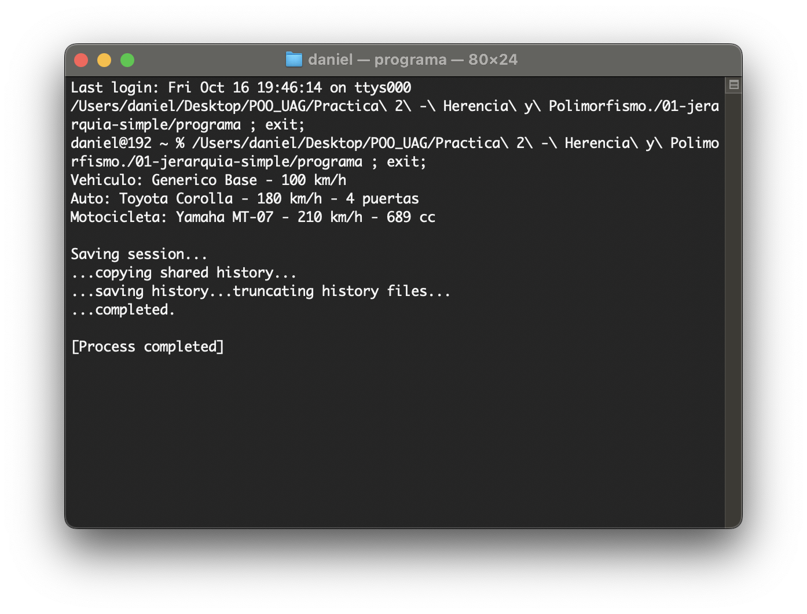
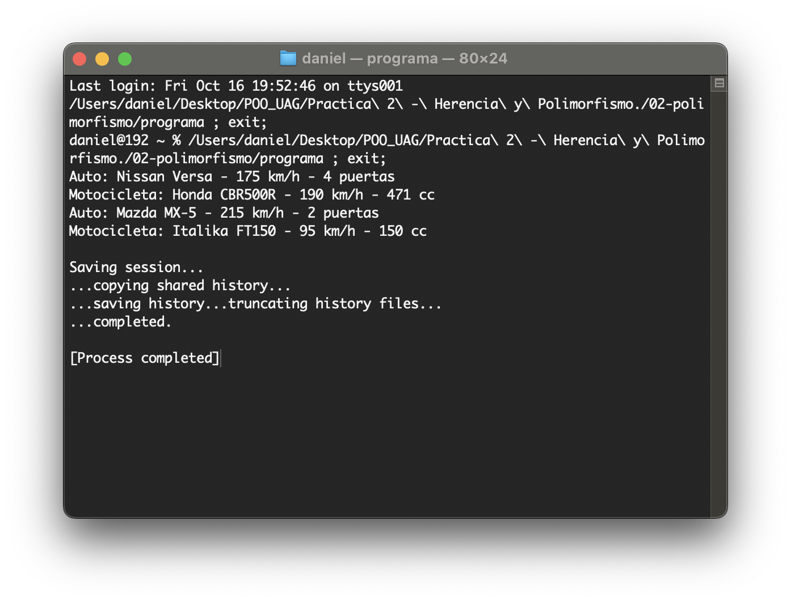
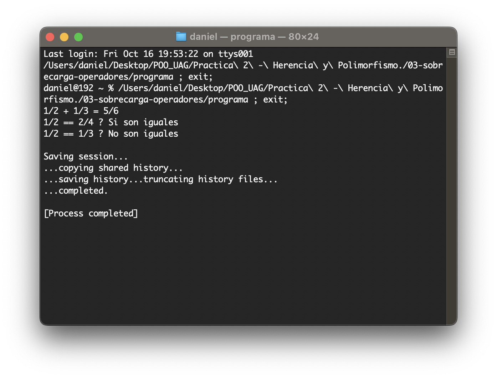
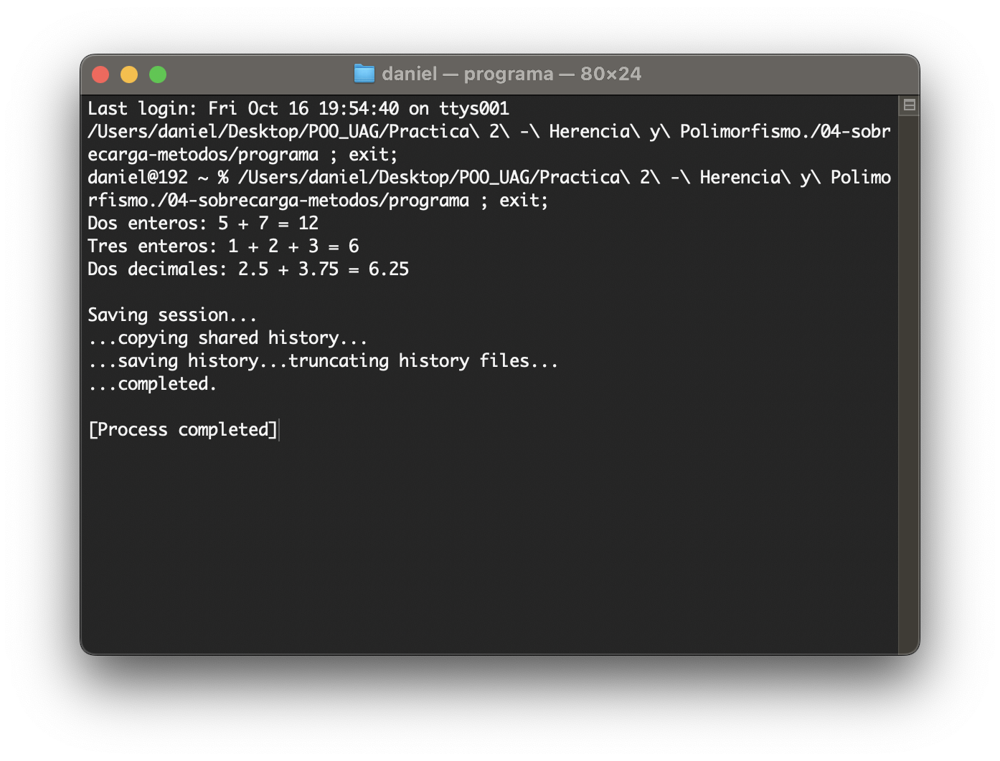
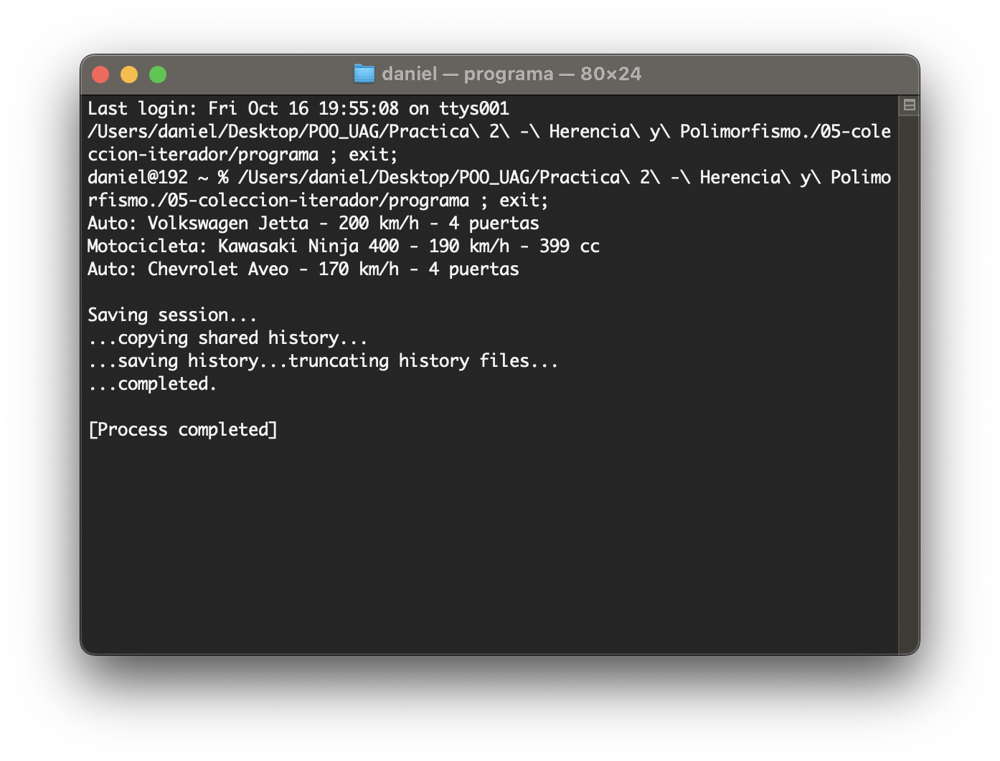

# Prácticas - 2do Parcial

## Unidad 3: Herencia y Polimorfismo

> Alumno: Daniel Ernesto Garrido Sánchez
> Matrícula: 5211038
> Licenciatura: Ing. de Software y Minería de Datos

Esta práctica integra 5 ejercicios para aplicar herencia, polimorfismo y sobrecarga en C++. Cada ejercicio separa la declaración de las clases (`.hpp`) de su implementación (`.cpp`) y cuenta con un `main.cpp` para comprobar su funcionamiento.

### Ejercicios.

| # | Programa | Descripción / Requisitos | Captura de pantalla |
|---|---|---|---|
| 1 | Jerarquía simple | Crear la clase base `Vehiculo` y las clases derivadas `Auto` y `Motocicleta`; mostrar la información de cada objeto. |  |
| 2 | Polimorfismo en acción | Guardar autos y motocicletas en un arreglo de punteros `Vehiculo*` y mostrar su información mediante un mismo método. |  |
| 3 | Sobrecarga de operadores | Crear la clase `Fraccion` y sobrecargar los operadores `+` y `==` para sumar y comparar fracciones. |  |
| 4 | Sobrecarga de métodos | Crear la clase `Calculadora` con distintas versiones del método `sumar()` para enteros y decimales. |  |
| 5 | Colección con iterador | Crear un `vector` de vehículos y recorrerlo con un iterador para mostrar la información de cada elemento. |  |

#### Reflexión de los ejercicios

Esta práctica me permitió entender cómo la herencia evita repetir código al crear clases que comparten características, como `Auto` y `Motocicleta` a partir de `Vehiculo`.

También comprendí que el polimorfismo permite tratar distintos objetos a través de una misma clase base, manteniendo un comportamiento específico para cada tipo de vehículo.

La sobrecarga de métodos y operadores mostró cómo una misma operación puede adaptarse a diferentes datos, mientras que el uso de vectores e iteradores facilitó el manejo de colecciones de objetos.
