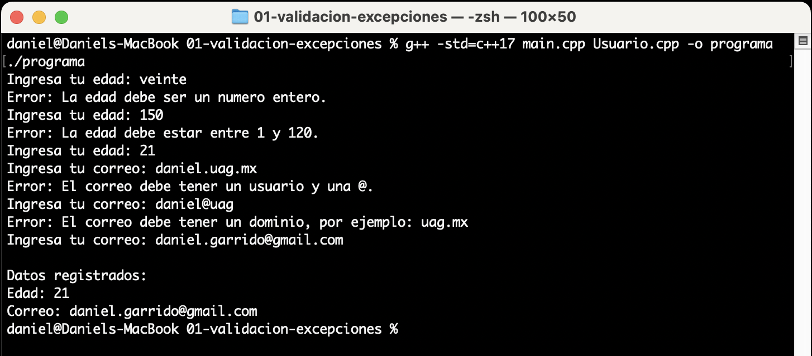
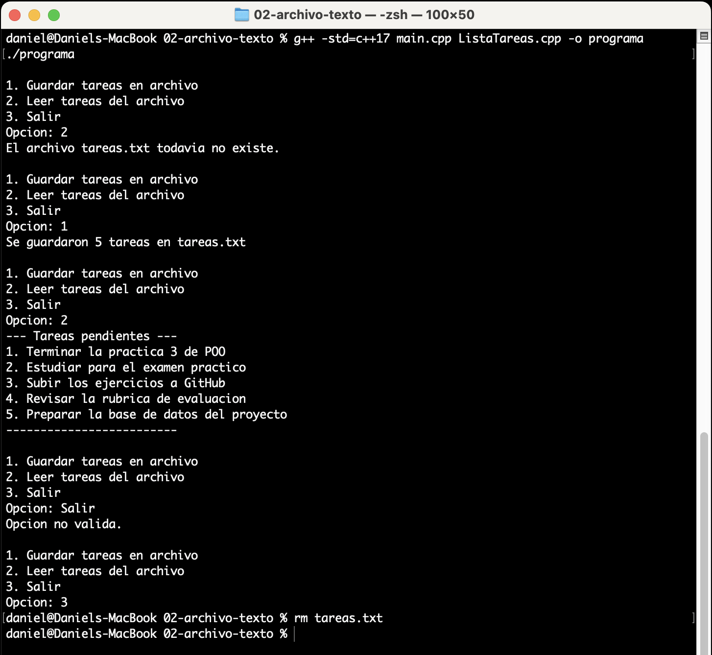
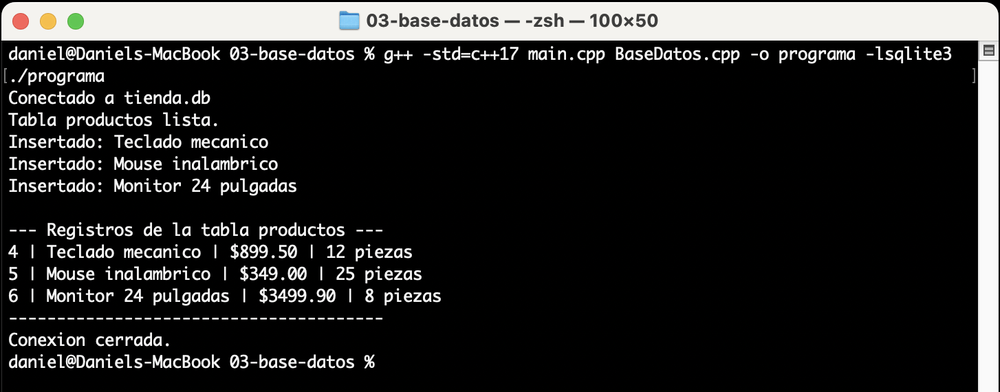
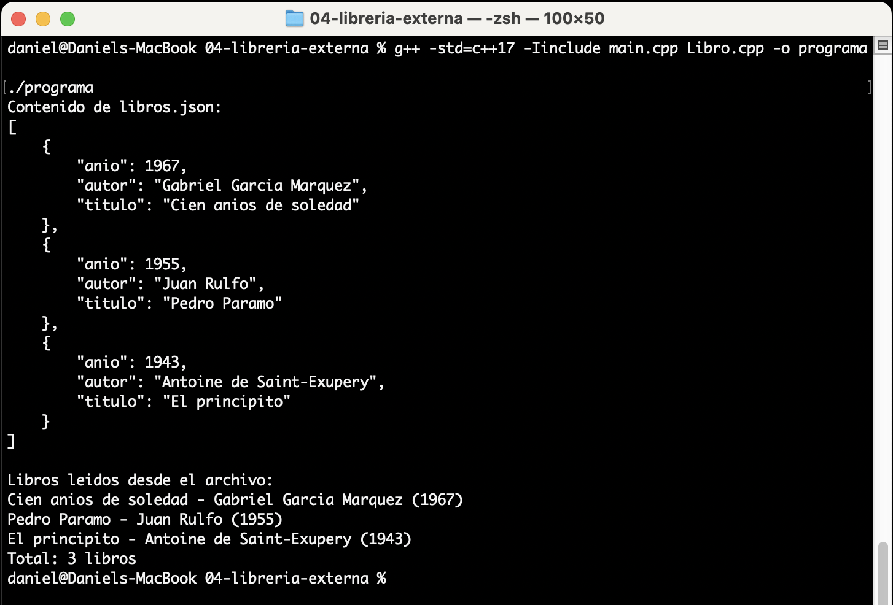
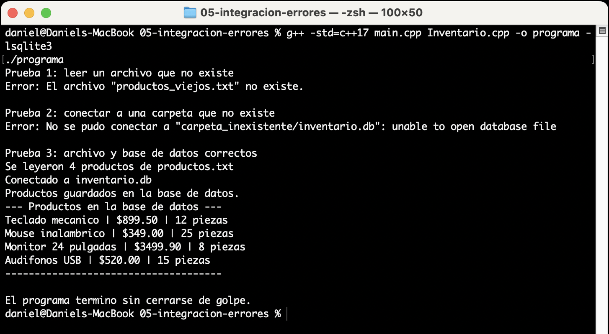

# Prácticas - 3er Parcial

## Unidad 4: Excepciones, Archivos y Bases de Datos

> Alumno: Daniel Ernesto Garrido Sánchez
> Matrícula: 5211038
> Licenciatura: Ing. de Software y Minería de Datos

Esta práctica integra 5 ejercicios en C++ para validar datos con excepciones, guardar información en archivos y conectarse a una base de datos SQLite. Cada ejercicio separa la declaración de las clases (`.hpp`) de su implementación (`.cpp`) y cuenta con un `main.cpp` para comprobar su funcionamiento.

### Ejercicios.

| # | Programa | Descripción / Requisitos | Captura de pantalla |
|---|---|---|---|
| 1 | Validación con excepciones | Pedir edad y correo a la clase `Usuario`; si un dato no es válido se lanza `std::invalid_argument` y el `main` la captura y vuelve a pedir el dato. |  |
| 2 | Archivo de texto | La clase `ListaTareas` guarda 5 tareas en `tareas.txt` y en otra opción del menú las lee y las muestra. |  |
| 3 | Conexión a base de datos | La clase `BaseDatos` se conecta a SQLite (`tienda.db`), crea la tabla `productos`, inserta 3 registros y los consulta. En la captura los `id` empiezan en 4 porque ya se había ejecutado antes (AUTOINCREMENT no reutiliza los id). |  |
| 4 | Librería externa | Con `nlohmann/json` la clase `Libro` se convierte a JSON, se guarda en `libros.json` y se vuelve a leer. |  |
| 5 | Integración con manejo de errores | La clase `Inventario` lee `productos.txt` y los guarda en SQLite; si el archivo no existe o la conexión falla, se muestra un mensaje en lugar de cerrar el programa. |  |

### Cómo compilar

```bash
g++ -std=c++17 main.cpp Usuario.cpp -o programa                       # 01
g++ -std=c++17 main.cpp ListaTareas.cpp -o programa                   # 02
g++ -std=c++17 main.cpp BaseDatos.cpp -o programa -lsqlite3           # 03
g++ -std=c++17 -Iinclude main.cpp Libro.cpp -o programa               # 04
g++ -std=c++17 main.cpp Inventario.cpp -o programa -lsqlite3          # 05
```

### Instalación de la librería externa (ejercicio 4)

`nlohmann/json` es una librería de un solo archivo (`json.hpp`), así que no se compila aparte. La descargué del release oficial dentro de la carpeta del ejercicio:

```bash
mkdir -p include/nlohmann
curl -L -o include/nlohmann/json.hpp https://github.com/nlohmann/json/releases/download/v3.11.3/json.hpp
```

En el código se usa con `#include <nlohmann/json.hpp>` y al compilar se agrega `-Iinclude`. También se puede instalar con `brew install nlohmann-json` y compilar con `-I$(brew --prefix)/include`.

#### Reflexión de los ejercicios

**Ejercicio 1 — Validación con excepciones.** Al principio leía la edad con `cin >> edad` y, cuando escribía letras, el programa se ciclaba.
Le pregunté a la IA por qué pasaba y me explicó que `cin` queda en estado de error; por eso cambié a leer la línea como texto y revisar que solo tuviera dígitos antes de convertirla.
Probé con "veinte", con 150 y con correos sin @ o sin dominio para comprobar que cada caso lanzara su excepción.
Para mejorar, validaría el correo de forma más completa, por ejemplo que no tenga espacios.

**Ejercicio 2 — Archivo de texto.** Mi duda fue por qué al guardar dos veces el archivo no tenía las tareas repetidas.
Con ayuda de la IA entendí que `ofstream` sobrescribe el archivo, y que para agregar al final se abre con `std::ios::app`.
También validé el caso de leer antes de que exista `tareas.txt` y que el menú no se cicle si se escriben letras.
En una siguiente versión dejaría que el usuario escriba sus propias tareas en lugar de tenerlas fijas en el código.

**Ejercicio 3 — Conexión a base de datos.** Lo más difícil fue entender cómo se usa la librería `sqlite3` en C++, sobre todo `prepare`, `bind` y `step`.
Usé la IA para ver ejemplos de sentencias preparadas y entender por qué son mejores que juntar el SQL con strings.
También me salía un error al compilar hasta que supe que hay que agregar `-lsqlite3`.
Para mejorar, revisaría el resultado de cada función de SQLite para mostrar un mensaje si alguna falla.

**Ejercicio 4 — Librería externa.** Mi dificultad fue saber cómo agregar una librería que no viene con C++ y cómo convertir mis objetos a JSON.
La IA me ayudó a entender que `nlohmann/json` solo necesita el archivo `json.hpp` y la opción `-Iinclude`, y me dio la idea de los métodos `aJson()` y `desdeJson()`.
Comprobé que el archivo `libros.json` se creara y que al leerlo se obtuvieran los mismos libros.
Como mejora, atraparía la excepción que lanza `json::parse` si el archivo está mal escrito.

**Ejercicio 5 — Integración con manejo de errores.** Pensé que `sqlite3_open` fallaba si la base de datos no existía, pero en realidad la crea.
Le pregunté a la IA cómo provocar un error real de conexión y me sugirió usar una carpeta que no existe, que fue lo que probé.
Organicé el programa en tres pruebas (archivo inexistente, conexión fallida y caso correcto) para ver que cada error se atrapa y el programa sigue.
Para mejorar, guardaría los errores en un archivo de registro además de mostrarlos en pantalla.

#### Uso de inteligencia artificial (IA)

Durante el desarrollo de las prácticas utilicé herramientas de inteligencia artificial como apoyo para comprender algunos conceptos de C++, resolver dudas sobre la implementación de los ejercicios y encontrar posibles soluciones a los errores que fueron apareciendo.

La utilicé principalmente para:

- **Comprender conceptos:** aclarar el funcionamiento de las excepciones, el manejo de archivos, las sentencias preparadas de SQLite y la conversión de objetos a JSON.
- **Resolver dudas de programación:** consultar ejemplos sobre el uso de funciones y librerías como `sqlite3` y `nlohmann/json`.
- **Depurar errores:** identificar posibles causas de errores de compilación y ejecución, así como comprender los mensajes que mostraba el programa.
- **Revisar y mejorar el código:** considerar alternativas para validar datos, controlar errores y administrar correctamente los recursos.

La inteligencia artificial fue una herramienta de consulta y orientación, no un sustituto del trabajo realizado. Revisé las sugerencias, las adapté a los requisitos de cada ejercicio y ejecuté pruebas para comprobar su funcionamiento. También analicé los problemas encontrados y documenté los aprendizajes obtenidos durante el desarrollo.

Considero que utilizar IA de manera responsable puede facilitar el aprendizaje de programación, siempre que se comprenda el código utilizado y se tenga la capacidad de explicar cómo funciona.
